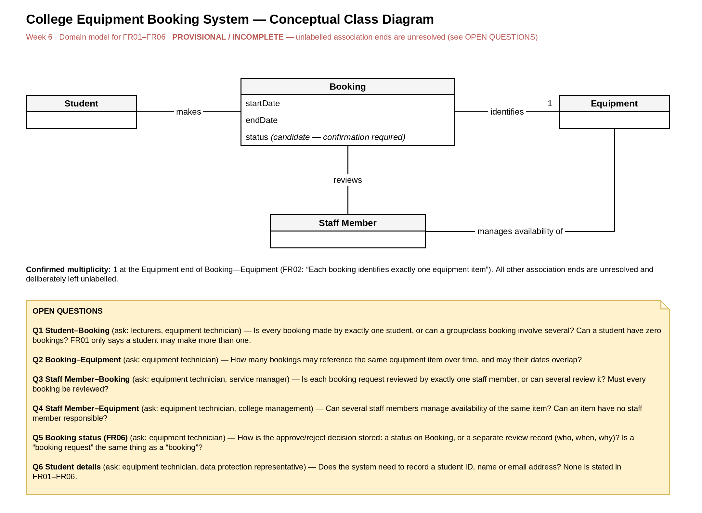
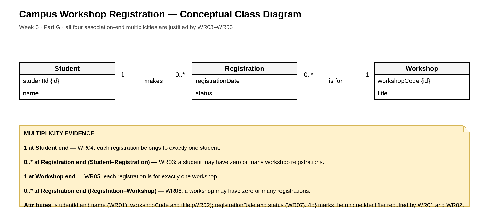

# Week 6 — Practical 6: Creating UML Class Diagrams

*SWEN61000 Requirements Engineering · Nathan Horan · Project: College Student Support Appointment System*

The same notes are also saved as `Week6_Notes.docx` in this folder.

These notes support the diagrams in this folder: **Week6_Equipment_Domain**, **Week6_Workshop_Domain** and **Project_Domain_Draft** (each saved as an editable .drawio file with a PNG export). FR01–FR06 are the Practical 6 case requirements for the College Equipment Booking System. They are numbered differently from the Week 3 candidate requirements (FR-01 to FR-03) in the earlier notes.

## Part A — Review of earlier work

Where each of the four main concepts appears in the case requirements and in the Week 4 and Week 5 models:

| Concept | Case requirements | Week 4 Use Case Diagram | Week 5 Activity Diagram |
|---|---|---|---|
| Student | FR01 | Actor “Student / user?” linked to View Equipment Availability and Create Booking | The person who selects equipment and a date and submits the booking (not drawn as an actor or swimlane) |
| Booking | FR01, FR02, FR03, FR04, FR06 | Use case Create Booking | Enter Booking Details, Submit Booking, Booking Recorded |
| Equipment | FR02, FR05 | Use cases View Equipment Availability and Record Equipment Return | Select Equipment, Check Availability, decision “Is equipment available?” |
| Staff Member | FR04, FR05 | Not shown as an actor (the diagram only asks who can create bookings and who records returns) | Not shown (there is no review or approval step) |

### Task A1

1. **Which requirement tells us that Booking is an important concept?** FR01 introduces it (a student can make more than one equipment booking). FR02, FR03, FR04 and FR06 then describe or act on bookings, so five of the six requirements involve Booking.
2. **Which requirement identifies two attributes of Booking?** FR03: each booking records a start date and an end date.
3. **Which requirements indicate relationships involving Staff Member?** FR04 (staff members review booking requests) links Staff Member to Booking. FR05 (staff members manage equipment availability) links Staff Member to Equipment.

## Part B — Domain concepts

### Task B1 — Candidate concepts

| Candidate | Class, attribute or action? | Supporting requirement | Notes |
|---|---|---|---|
| Student | Class | FR01 | The person who makes bookings. |
| Booking | Class | FR01, FR02, FR03, FR04, FR06 | The central concept; most requirements mention it. |
| Start date | Attribute (of Booking) | FR03 | Shown as startDate. |
| Equipment | Class | FR02, FR05 | FR02 calls it an “equipment item”. |
| Review | Action | FR04 | Becomes the association label “reviews”, not a class. It would only become a class if the system had to keep a record of each review (who, when, why), which FR04 and FR06 do not say (see Q5). |
| Staff Member | Class | FR04, FR05 | The person who reviews bookings and manages availability. |
| End date | Attribute (of Booking) | FR03 | Shown as endDate. Added to the lab’s list. |
| Make (a booking) | Action | FR01 | Becomes the association label “makes”. |
| Manage availability | Action | FR05 | Becomes the association label “manages availability of”. |
| Approved / rejected | Candidate attribute value (Booking status) | FR06 | FR06 suggests the decision is recorded but not how, so status is labelled candidate. |

### Task B2 — The four main classes

| Class | Why it is relevant to the College Equipment Booking System |
|---|---|
| Student | Students are the people who make equipment bookings (FR01), so the system must be able to say who a booking is for. |
| Booking | A booking is the central record: it has a start and end date (FR03), identifies one equipment item (FR02) and is reviewed and approved or rejected (FR04, FR06). |
| Equipment | Equipment is what a booking reserves (FR02) and what staff manage the availability of (FR05). |
| Staff Member | Staff members review booking requests (FR04) and manage equipment availability (FR05). |

### Task B3 — Uncertainty

These things seem useful but are not confirmed by FR01–FR06, so they are not in the diagram.

| Candidate | Why it seems useful | Why it is not modelled | Who would confirm it |
|---|---|---|---|
| Student email address | Lets staff tell a student whether a booking was approved or rejected (FR06). | Not in FR01–FR06, and it is personal data. | Equipment technician (what they need) and the data protection representative (whether it may be collected). |
| Return date | The Week 1 and Week 3 notes say technicians need to know what is due back. | FR03 only gives a start and end date; it is unclear whether endDate is the return date. | Equipment technician. |
| Availability (as an attribute or concept) | FR05 and the Week 5 activity diagram both refer to it. | FR05 does not say whether availability is stored on Equipment or worked out from bookings. | Equipment technician. |

**Checkpoint:** four core classes (Student, Booking, Equipment, Staff Member) and six documented open questions (see Part E).

## Parts C and D — Class Diagram, attributes and associations

*Figure 1: Week6_Equipment_Domain (provisional / incomplete)*

### Task D1 — Attributes

- **Booking:** startDate and endDate (FR03). status is included but labelled “candidate — confirmation required” because FR06 does not say how the approval decision is stored.
- **Student, Equipment, Staff Member:** class name only. FR01–FR06 do not justify any attribute for them, so none were invented.

### Task D2 — Relationships

| Class 1 | Relationship label | Class 2 | Evidence |
|---|---|---|---|
| Student | makes | Booking | FR01 |
| Booking | identifies | Equipment | FR02 |
| Staff Member | reviews | Booking | FR04 |
| Staff Member | manages availability of | Equipment | FR05 |

All four are plain solid lines. No inheritance arrows, aggregation diamonds or composition diamonds are used.

### Task D3 — Reading the relationships aloud

- “Student makes Booking.”
- “Booking identifies Equipment.”
- “Staff Member reviews Booking.”
- “Staff Member manages availability of Equipment.”

Each one forms a meaningful sentence that someone unfamiliar with the system could follow.

## Part E — Multiplicity and requirements questions

### Task E1 — Confirmed multiplicity

FR02 says each booking identifies exactly one equipment item, so **1** is placed at the Equipment end of the Booking—Equipment association. Each Booking identifies exactly one Equipment item.

### Task E2 — What remains unknown

| Association | What is known? | What needs clarification? | Multiplicity on diagram |
|---|---|---|---|
| Student—Booking | FR01 allows more than one booking per student. | Is a booking associated with exactly one student? Are zero bookings permitted? | None. FR01 suggests “many” at the Booking end, but the lower bound and the Student end are unknown. |
| Booking—Equipment | Each booking identifies one item (FR02). | How many bookings may reference the same item over time? | 1 at the Equipment end (confirmed). Booking end unresolved. |
| Staff Member—Booking | Staff review requests (FR04). | Is one reviewer assigned, or can several review the same booking? | None. |
| Staff Member—Equipment | Staff manage availability (FR05). | Can several staff members manage the same equipment? | None. |

The unresolved ends are left unlabelled only because the diagram is marked provisional / incomplete. An omitted end does not mean “zero or many”, and “?” is not used as a multiplicity.

### Task E3 — Open questions

| # | Question | Relates to | Who to ask |
|---|---|---|---|
| Q1 | Is every booking made by exactly one student, or can a group or class booking involve several? Can a student have zero bookings? | Student—Booking, FR01 | Lecturers, equipment technician |
| Q2 | How many bookings may reference the same equipment item over time, and may their dates overlap? | Booking—Equipment, FR02 | Equipment technician |
| Q3 | Is each booking request reviewed by exactly one staff member, or can several review it? Must every booking be reviewed? | Staff Member—Booking, FR04 | Equipment technician, service manager |
| Q4 | Can several staff members manage availability of the same item? Can an item have no staff member responsible? | Staff Member—Equipment, FR05 | Equipment technician, college management |
| Q5 | How is the approve/reject decision stored: a status on Booking, or a separate review record (who, when, why)? Is a “booking request” the same thing as a “booking”? | Booking status, FR04, FR06 | Equipment technician |
| Q6 | Does the system need to record a student ID, name or email address? | Student, B3 | Equipment technician, data protection representative |

## Part F — Review of the Class Diagram

### Task F1 — Requirements-to-model check

| Requirement | Where is it represented in the diagram? | Fully represented? | Comment |
|---|---|---|---|
| FR01 | Student—Booking relationship | Partially | The relationship is shown, but “more than one” is not drawn as a multiplicity because the bounds and the Student end are unconfirmed (Q1). |
| FR02 | Booking—Equipment relationship and 1 | Yes | “Exactly one equipment item” is the 1 at the Equipment end. |
| FR03 | Booking attributes startDate and endDate | Yes | Both attributes are on Booking. |
| FR04 | Staff Member—Booking relationship | Partially | The relationship is shown. The number of reviewers is unknown (Q3), and a booking request is not distinguished from a booking (Q5). |
| FR05 | Staff Member—Equipment relationship | Needs clarification | Availability is not modelled as an attribute or concept, and the number of managers is unknown (Q4). |
| FR06 | Booking decision / status question | Needs clarification | A decision may need to be recorded, but how is unknown (Q5). status is only a candidate. |

### Task F2 — Comparison with the earlier models

- **Does each important class have a role in the requirements?** Yes. Student (FR01), Booking (FR01–FR04, FR06), Equipment (FR02, FR05) and Staff Member (FR04, FR05) all appear in the requirements. Student, Booking and Equipment also appear in the Week 4 use case diagram, and Booking and Equipment in the Week 5 activity diagram.
- **Are the relationships meaningful?** Yes. Each reads as a sentence (D3) and has a requirement ID as evidence (D2).
- **Are the attributes on the correct classes?** Yes. startDate and endDate are on Booking (FR03), and the candidate status is on Booking (FR06). No other class has attributes.
- **Has anything unsupported been introduced?** Only the candidate status attribute, which is labelled as a candidate. Email address, return date and availability were deliberately left out (B3), and no inheritance, aggregation or composition was used.
- **Is there important information in the earlier diagrams that the domain model does not explain?** Yes, three things, listed below.

1. **Review step.** The Week 5 activity diagram goes from Submit Booking straight to Booking Recorded, with no review. FR04 and FR06 say staff review requests and approve or reject them, and the class diagram shows that. The two models disagree. Question: is review part of the booking process, and is a booking “recorded” before it is reviewed?
2. **Staff Member and returns.** The Week 4 use case diagram has no Staff Member actor, although FR04 and FR05 give staff two responsibilities. Its Record Equipment Return use case also has no matching concept in the class diagram: there is no return or expected return date, and it is unclear whether endDate plays that role.
3. **Availability.** Both View Equipment Availability (Week 4) and Check Availability (Week 5) depend on availability. The class diagram only shows it inside the label “manages availability of”. Whether it is an attribute of Equipment or worked out from bookings is still open (Q4, B3).

## Part G — Campus Workshop Registration

### Task G1 — Classes

Three main concepts: **Student**, **Workshop** and **Registration**. Registration is a student’s registration for a particular workshop (WR03–WR07).

### Task G2 — Attributes

| Class | Attributes | Evidence |
|---|---|---|
| Student | studentId, name | WR01 (each student has a unique student ID and a name) |
| Workshop | workshopCode, title | WR02 (each workshop has a unique workshop code and a title) |
| Registration | registrationDate, status | WR07 (each registration records a registration date and status) |

{id} after studentId and workshopCode marks the unique identifier required by WR01 and WR02.

### Task G3 — Associations

- Student **makes** Registration.
- Registration **is for** Workshop.

There is no direct Student—Workshop association. Registration sits between them because it has its own attributes (registrationDate and status, WR07), which a direct association could not hold.

### Task G4 — Multiplicities

| Association end | Multiplicity | Requirement | Justification |
|---|---|---|---|
| Registration end of Student—Registration | 0..\* | WR03 | A student may have zero or many workshop registrations. |
| Student end of Student—Registration | 1 | WR04 | Each registration belongs to exactly one student. |
| Workshop end of Registration—Workshop | 1 | WR05 | Each registration is for exactly one workshop. |
| Registration end of Registration—Workshop | 0..\* | WR06 | A workshop may have zero or many registrations. |

*Figure 2: Week6_Workshop_Domain*

### Task G5 — Interpreting the model

1. One Student can have **zero or many (0..\*)** Registration records.
2. Each Registration belongs to **exactly one (1)** Student.
3. One Workshop can have **zero or many (0..\*)** Registration records.
4. Each Registration is for **exactly one (1)** Workshop.

### Optional extension — Facilitator

The extra requirement needs one new class, **Facilitator**, and one new association, **Workshop is led by Facilitator** (read from the other side: Facilitator leads Workshop).

- **1** at the Facilitator end: each workshop is led by exactly one facilitator.
- **0..\*** at the Workshop end: a facilitator may lead zero or many workshops.
- No Facilitator attributes are stated, so none are added. A name or contact detail would need confirming first.

This extension is not drawn in Week6_Workshop_Domain, which stays as the required three-class diagram.

## Part H — Individual project: College Student Support Appointment System

*Figure 3: Project_Domain_Draft (initial draft, provisional / incomplete)*

### Task H1 — Four candidate domain concepts

| Concept | Where it comes from in the project | Notes |
|---|---|---|
| Appointment | FR01, FR03, FR04, FR05 | The central concept. FR04 gives its attribute: the date and time. |
| Support Service | FR02, FR03 | The services students can book. FR03 associates each appointment with one. |
| Student | Scenario; CR02 (students request appointments); NFR01 (personal information) | No catalogue requirement names Student directly yet. |
| Staff Member | FR01 (“authorised user”); student support staff stakeholder | The exact role is unconfirmed (Q01), so the name is provisional. |

**Considered but not modelled:** Support Administrator (stakeholder role not yet confirmed), Availability / time slot (the scenario says availability is unclear, but no requirement defines it), Schedule (a view of appointments in FR01, not a separate thing) and Appointment Type (may be the same as Support Service).

### Task H2 — Associations

| Class 1 | Relationship label | Class 2 | Evidence |
|---|---|---|---|
| Student | has | Appointment | Scenario, CR02 |
| Appointment | is for | Support Service | FR03 |
| Staff Member | views | Appointment | FR01 |

### Task H3 — Multiplicity

**1** at the Support Service end of Appointment—Support Service. FR03 says to associate each appointment with “the relevant support service”, which is singular. FR03 is still a proposed Should requirement, so the service manager should confirm it (PQ2). All other ends are left unlabelled because nothing in the catalogue supports them yet.

### Task H4 — Question requiring clarification

**PQ1:** Is “Staff Member” one class, or must student support staff and support administrators be separate classes (who is the “authorised user” in FR01)? Is a staff member assigned to an appointment, or do they only view it? Ask the service manager and student support staff (Q01).

Also recorded on the diagram: **PQ2** (can an appointment cover several students or services, and can a student have zero appointments?) and **PQ3** (which student details may be stored, given NFR01?).

## Files in 06-domain-model/

- Week6_Equipment_Domain.drawio and Week6_Equipment_Domain.png
- Week6_Workshop_Domain.drawio and Week6_Workshop_Domain.png
- Week6_Notes.docx (the same notes as a Word document)
- Project_Domain_Draft.drawio (with a PNG export, Project_Domain_Draft.png, for convenience)
