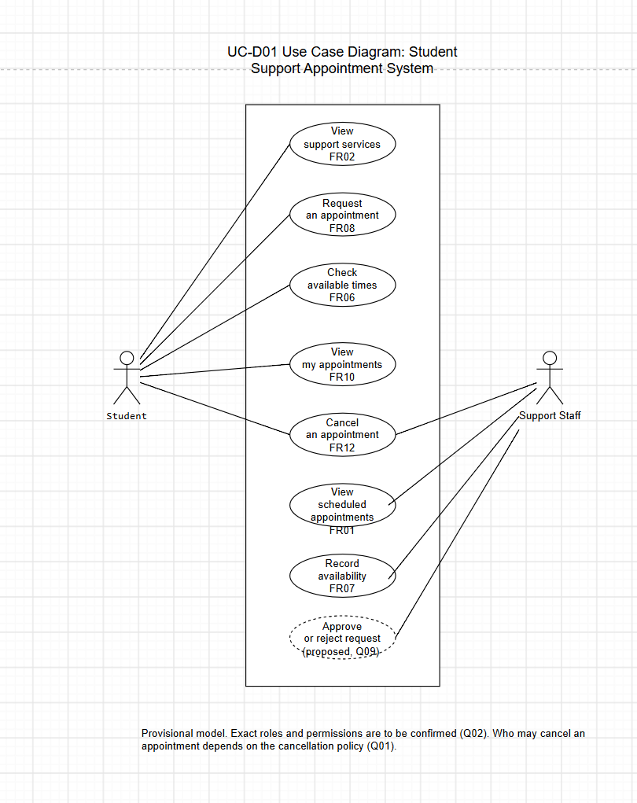
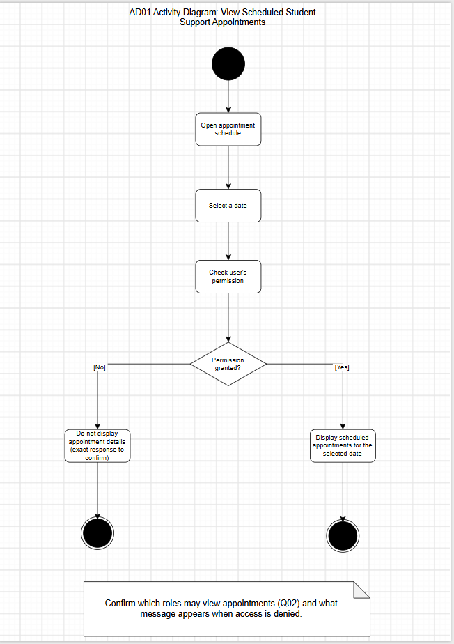
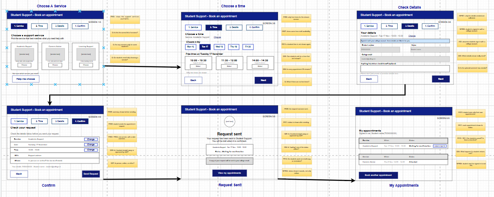
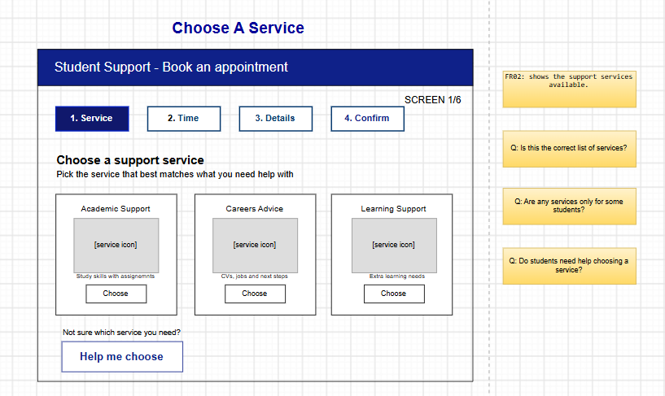
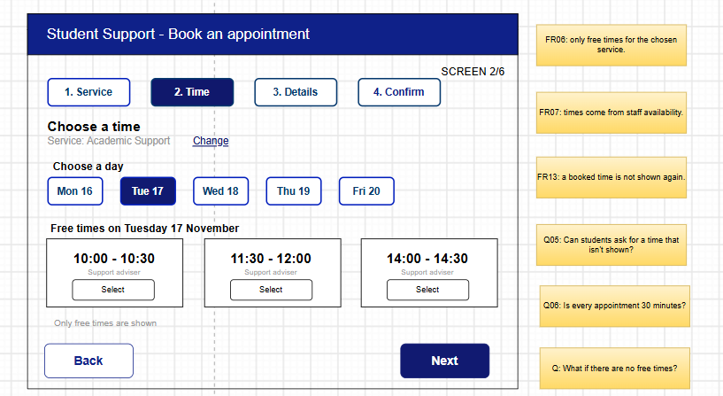
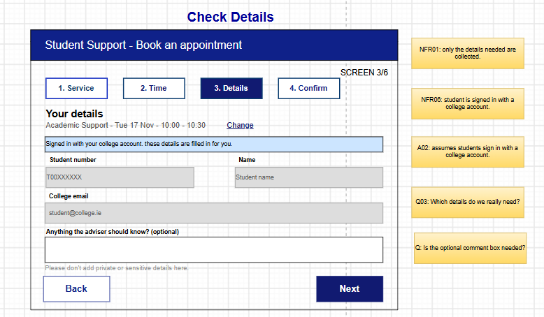
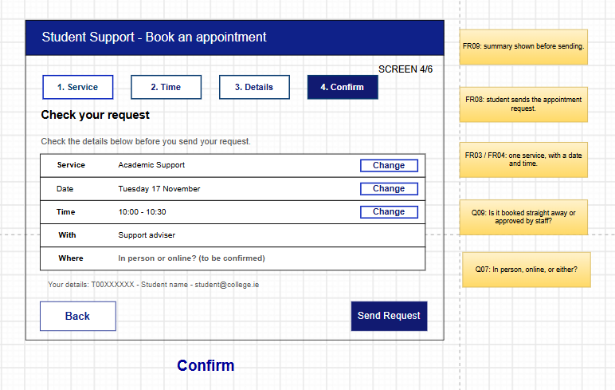
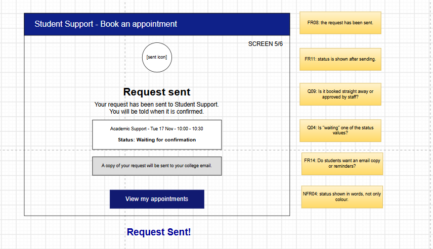
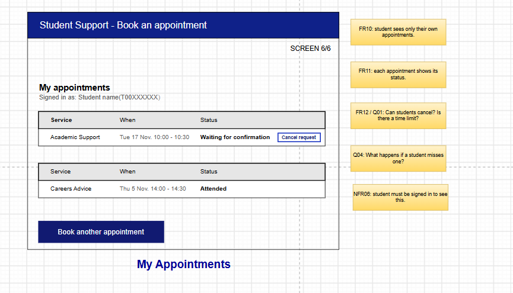

# Requirements Engineering Project — Draft Sections 1–10

**Scenario B: College Student Support Appointment System**

## 1. Problem, Stakeholders and Goals

### 1.1 Background and current situation

The college has student support services such as academic support, careers advice and learning support.

Currently students are contacting the services by email or phone calls. For staff, they are scheduling appointments with calendars, spreadsheets or other informal ways.

This means it can be challenging for students to locate the service they require or check for the appointment availability. Also, staff may spend time manually managing the appointments. It can be challenging to make changes or cancellations. It's important to ensure the student's information is secure and that the system is accessible and user friendly.

All these issues are directly derived from Scenario B. We need to do more research to figure out the exact procedures for the college.

### 1.2 Problem statement and goals

**Problem:** Right now we have a mix of different informal processes for making appointments. That makes it difficult for students to find the right help, and difficult for staff to track appointments.

**Goals:**
- Assist students in finding appropriate support services
- Ease the process of determining availability of appointments
- Minimise manual processing of appointments
- Ease the process of making adjustments to appointments
- Protect students' data
- Ensure accessibility and usability

**Expected benefits:**
- Students can find the right service and see free times without having to email or phone.
- Staff spend less time arranging and changing appointments by hand.
- Fewer double bookings than with the current calendars and spreadsheets (FR13).
- Changes and cancellations are easier for students and staff to manage.
- Only the student data that is needed is collected, and it is kept in one secure system (NFR01, NFR06).
- Students with accessibility needs can book support themselves (NFR04).

These are expected benefits based on Scenario B. They have not been measured or confirmed with stakeholders.

### 1.3 Stakeholders, needs and proposed elicitation

**What are the proposed elicitation techniques:**
I would perform interviews to assess needs for students and staff. I would also look at existing forms and calendars for appointments (if available) to understand how the process works.

Interviews suit this project because the main gaps are rules that only support staff can answer, such as who can cancel an appointment (Q01), whether a request needs staff approval (Q09) and what information has to be recorded (Q03). Students can also explain in their own words where the current email and phone process is difficult, and I can ask follow-up questions when an answer is unclear.

Looking at existing forms and calendars suits this project because it shows what information is actually recorded now and how staff schedule appointments, without relying only on what people remember. It also lets me check what staff say in interviews against how the process really works.

**What will you be asking:**
1. Students: what's the challenge to get a proper service or appointment.
2. Staff: who can make/alter/cancel appointments, what information is required.

| Stakeholder / role | Need or concern | Evidence / source |
|---|---|---|
| Student | Find the right service, check availability, and arrange appointments. They also need privacy. | Scenario B & Week 2 Lab |
| Student support staff | View appointments, manage availability and handle changes. | Scenario B & Week 2 Lab |
| IT support staff | Maintaining the system and preventing technical issues or unauthorised access. | Week 1 & 2 Labs |
| College management | Reduce manual appointment handling, oversee support services and make sure student data is handled in line with data protection rules. | Assumed stakeholder based on Scenario B; to be confirmed |

### 1.4 Scope and system boundary

**In:** Show support services. Can check availability of appointments. Log appointments. View schedules. Cancel appointments in line with the agreed policy (FR12, Q01); whether appointments can also be changed is to be confirmed. Students request appointments online and view their own appointments. Support staff record the times they are available.

**Out:** Actually provide support services. Build separate mobile app. Integration with other systems at the college.

**Constraints:** Need to make sure student info is secure. Need to take accessibility and differing availabilities of staff into account.

### 1.5 Assumptions, candidate requirements and open questions

| ID | Type | Description | Evidence / status | Action needed |
|---|---|---|---|---|
| A01 | Assumption | Each appointment involves one student. | Not confirmed | Clarify with support staff |
| CR01 | Candidate requirement | Students should receive appointment reminders. | Partly covered by FR14 (Could), which only sends a confirmation when a request is sent. Reminders are not covered. | Ask students and support staff whether reminders are needed, and when |
| Q01 | Open question | Can students cancel appointments? | No rule supplied | Confirm cancellation policy |
| CR02 | Candidate requirement | Students should be able to request appointments online. | No rule supplied; recorded as FR08 (Must) | Ask students and support staff |
| Q02 | Open question | Who can create, change or cancel appointments? | Not specified | Confirm roles and permissions |
| Q03 | Open question | What information must be recorded for an appointment? | No rule supplied | Ask support staff and consider privacy needs |
| Q04 | Open question | What should happen when a student cancels or misses an appointment? | Not specified | Ask students and support staff |
| CR03 | Candidate requirement | Support staff should be able to record the times they are available for appointments. | Raised during domain modelling (CD01); recorded as FR07 | Confirm with support staff who manages availability |
| A02 | Assumption | Students and support staff sign in with an existing college account. | Not confirmed; basis of NFR06 | Confirm with IT support staff |
| Q05 | Open question | Can appointments be booked outside published availability slots? | Raised during domain modelling (CD01) | Confirm with support staff |
| Q06 | Open question | Are appointments a fixed length, or does the length vary by service? | Raised during prototyping (Screen 2) | Confirm with support staff |
| Q07 | Open question | Are appointments in person, online, or either? | Raised during prototyping (Screen 4) | Confirm with support staff |
| A03 | Assumption | The booking form needs only student number, name, college email and an optional comment. | Not confirmed; basis of the refined NFR01 | Confirm with support staff (Q03) |
| Q08 | Open question | Do support staff sign in with the same college account system as students, or a separate staff login? | Raised in Lab 8 (NFR06) | Confirm with IT support staff |
| Q09 | Open question | Is a student's appointment request confirmed straight away, or does a member of support staff approve it first? | Raised in Lab 9 (FR08, US01). Not confirmed. | Confirm with support staff and college management |

## 2. Requirements Catalogue

See [`../requirements/requirements-catalogue.md`](../requirements/requirements-catalogue.md) (20 requirements: FR01–FR14 and NFR01–NFR06). Every requirement is marked "Candidate, to be confirmed with stakeholders", because none have been confirmed by real stakeholders.

### 2.1 Requirements notes

The questions below (Who, What, When, Why and How will we know) were used to analyse the first version of FR01, before it was revised in Week 10. That version let "an authorised user" view scheduled student support appointments.

- Who? An authorised user; the exact role is unknown.
- What? View scheduled student support appointments.
- When? When the user opens the appointment schedule.
- Why? To let the relevant user see scheduled appointments.
- How will we know? Test that an authorised account can view appointments and that access follows the agreed permissions.
- Ambiguity: the first version of FR01 said 'authorised user', and FR05 and NFR02 talk about permissions, but none of them said which roles are meant. UC-D01 now separates Student and Support Staff, but the exact permissions are still open (Q02). FR01 was revised in Week 10 to name Support Staff and a selected date, so it now matches UC-D01 and AD01.
- Overlap: FR05 and NFR02 both cover access control. FR05 states the function (restricting who can view appointments) and NFR02 the security quality for all appointment information. They could be merged once the access rules are confirmed.
- NFR03 is about reviewing the prototype, which is a process requirement rather than a property of the system. Its first wording ("applicable accessibility criteria") could not be verified, so in Week 10 I reworded it to list the four WCAG 2.2 criteria it checks. NFR04 covers accessibility of the system itself.
- Missing requirements: the first catalogue only covered staff viewing appointments. Domain modelling (CD01) and prototyping identified FR06–FR14 for availability, booking, appointment status, cancellation and confirmations. CR02 and CR03 are now recorded as FR08 and FR07. CR01 is only partly covered by FR14, which sends a confirmation, not a reminder.
- Unconfirmed rules: FR08 (instant booking or staff approval, Q09), FR11 (status values, Q04 and Q09) and FR12 (cancellation policy, Q01) depend on rules that have not been supplied. They are written so they can be verified once the rule is agreed, and remain candidate requirements.
- Verifiability: words such as 'agreed' in FR02 and NFR02 mean verification depends on information that is not yet confirmed. NFR01 had the same problem and was refined in Week 8 to name the fields collected. The 3-minute target in NFR05 is a proposed value that needs to be agreed with stakeholders.
- Possible conflict: FR14 (email confirmation) must not send more personal information than necessary, so it has to be checked against NFR01.

## 3. Requirements Modelling

### 3.1 Use Case Diagram (UC-D01)

Source file: [`UC-D01-use-case-diagram.drawio`](../diagrams/UC-D01-use-case-diagram.drawio)

UC-D01 shows the two main actors, Student and Support Staff, and the main use cases inside the system boundary. Each use case is labelled with the requirement it relates to. Students view services, check available times, request appointments, view their own appointments and cancel appointments (FR02, FR06, FR08, FR10, FR12). Support staff view the schedule, record their availability and may cancel appointments (FR01, FR07, FR12). The model is provisional because the exact roles and permissions (Q02) and who may cancel (Q01) are not confirmed. A proposed use case, "Approve or reject request", is shown with a dashed outline for Support Staff. It is only needed if booking is not instant (Q09). Use cases that are not in the project brief are candidates, to be confirmed with stakeholders.

### 3.2 One Use Case Narrative

| Field | Your content |
|---|---|
| Use case / ID | UC01 — View Scheduled Student Support Appointments |
| Primary actor / goal | Support staff (authorised user; exact role to be confirmed, Q02). Goal: View scheduled student support appointments. |
| Preconditions / trigger | The user opens the appointment schedule. The user's access permissions must be checked. |
| Main successful flow | 1. The user opens the appointment schedule. 2. The user selects a date. 3. The system checks the user's permission. 4. The system displays the scheduled appointments if permission is granted. |
| Alternative / exception flows | If the user is not permitted to view appointments, the appropriate response needs confirmation from the relevant stakeholder. |
| Outcome / postconditions | The authorised user can view the scheduled appointments they have permission to access. |
| Related requirements | FR01, FR05, NFR02, NFR06 |

### 3.3 Activity Diagram (AD01)

Source file: [`AD01-activity-diagram.drawio`](../diagrams/AD01-activity-diagram.drawio)

AD01 shows the workflow for viewing scheduled appointments, matching UC01. The user opens the schedule, selects a date and the system checks their permission. The guards [Yes] and [No] show the two outcomes. The response when access is denied is not specified in the scenario, so it is marked as needing confirmation. AD01 relates to FR01, FR05 and NFR02. The steps are candidates, to be confirmed with support staff (Q02).

### 3.4 Conceptual UML Class Diagram (CD01)

Source file: [`CD01-class-diagram.drawio`](../diagrams/CD01-class-diagram.drawio)

Figure CD01 illustrates the key concepts of the domain as found in the Student Support Appointment system, and their inter-relationships. It is a conceptual view of the problem domain, so it has no methods or database tables. Only those attributes that are necessary to support appointment making are identified (per NFR01). If a multiplicity depends on an unconfirmed rule, that is noted as an assumption or question (table below). Classes, attributes and multiplicities that are not in the project brief (for example AvailabilitySlot and Appointment.status) are candidates, to be confirmed with stakeholders. The note on the diagram still lists the older status values. The Appointment.status row below has the current list, which adds "waiting for confirmation" (Q09). 

| Association / feature | Requirement evidence | Open question / assumption |
|---|---|---|
| Student 1 — 0..* Appointment (attends) | FR01, FR04; Scenario B | No appointment has more than one student assigned (A01). The number of appointments may range from zero (no appointments) to many. Group appointments are not modelled. |
| SupportService 1 — 0..* Appointment (is provided in) | FR02, FR03 | Each appointment is for exactly one service. A service may have no appointments yet. |
| AvailabilitySlot 1 — 0..1 Appointment (is booked as) | FR06, FR13; goal: ease checking availability | One slot holds at most one appointment, and slots may remain unbooked. Whether appointments can be made outside published slots is unconfirmed (Q05). |
| AvailabilitySlot 0..* — 1 SupportStaff (is offered by) | FR07; Section 1.3: staff manage availability | Each slot belongs to one staff member. Who creates slots, staff or an administrator, is unconfirmed (Q02). |
| SupportService 1..* — 1..* SupportStaff (is delivered by) | Scenario B; FR02 | Assumes each service has at least one staff member and staff may work across more than one service. To be confirmed with support staff. |
| Appointment.status | FR11; Q01, Q04, Q09 | Status values (for example waiting for confirmation, booked, cancelled, attended, missed) depend on the booking, cancellation and no-show policies, which are unconfirmed. |
| Student attributes (studentNumber, name, collegeEmail) | NFR01, FR05, NFR02 | Assumed minimum identifying information. The required data is to be confirmed (Q03). |

### 3.5 Model consistency check

The models were checked against each other and against the requirements catalogue to find mismatches, gaps and new questions. The use case narrative (UC01) and activity diagram (AD01) agree. Both follow the same flow: open the schedule, select a date, check permission, then display appointments if permission is granted. Both trace to FR01, FR05 and NFR02. The class diagram (CD01) supports FR02, FR03 and FR04 through the SupportService and Appointment classes and the date and time attributes. However, modelling revealed several inconsistencies and gaps, summarised below.

| Finding | Models affected | Action / status |
|---|---|---|
| UC-D01 originally used one generic 'Authorised user' actor, while CD01 separates Student and SupportStaff. | UC-D01, UC01, CD01 | UC-D01 updated with Student and Support Staff actors. Exact roles and permissions still to be confirmed (Q02). Partly resolved. |
| UC-D01 and AD01 originally only modelled viewing appointments. The goals and scope in Section 1 also include finding services, checking availability, requesting and cancelling appointments. | UC-D01, AD01, Section 1 | Use cases added to UC-D01 and FR06–FR12 added to the catalogue. AD01 still models the staff viewing flow; the student booking flow is explored in the prototype (Section 4). Resolved. |
| UC01 listed FR09, which did not exist in the catalogue at the time. | UC01 | Corrected to FR05. Resolved. |
| CD01 includes AvailabilitySlot, but no requirement covered staff recording their availability. | CD01, catalogue | Recorded as CR03 and added as FR07. Who manages availability is still open (Q02). Resolved. |
| The 0..1 multiplicity between AvailabilitySlot and Appointment implies a slot cannot be booked twice, but no requirement stated this. | CD01, catalogue | FR13 added. Resolved. |
| Appointment.status in CD01 implies a lifecycle (booked, cancelled, attended, missed) that no requirement or activity diagram covered. | CD01, AD01 | FR11 added. The status values depend on the cancellation and no-show policy (Q01, Q04). Open. |
| The denied-access outcome is unspecified in both UC01 and AD01. | UC01, AD01 | The models agree, but the response is unknown. Confirm the message or next action with stakeholders. Open. |
| CD01 links staff to appointments only through AvailabilitySlot. If appointments can be booked outside published slots, Appointment would need a direct link to SupportStaff. | CD01 | Depends on Q05. Open. |
| Student attributes in CD01 are assumed. NFR01 requires collecting only necessary data. | CD01, NFR01 | Confirm required student information (Q03). Open. |

Overall, the models are consistent for the 'view appointments' flow, but modelling showed that the first version of the requirements focused too narrowly on staff viewing schedules. FR06–FR14 were added to cover availability, booking, appointment status, cancellation and confirmations, and the use case diagram was updated to match. The remaining open items depend on stakeholders confirming user roles, the cancellation and no-show policy, and the information to be recorded.

## 4. Low-fidelity Prototype

### 4.1 Journey and purpose

The prototype explores the journey of a student requesting an appointment with a student support service. It covers choosing a service, choosing an available time, checking their details, reviewing and sending the request, and then viewing their appointments. This journey was chosen because the model consistency check (Section 3.5) showed that the original models and requirements focused mainly on staff viewing scheduled appointments. The student side of the process, which is central to the problem described in Section 1, had not yet been explored. 

The prototype was used to investigate:
- whether the booking steps are clear and in a sensible order
- what information the student needs at each step to make a decision
- how staff availability could be shown to students (FR06, FR07)
- what personal information is genuinely needed (NFR01, Q03)
- where cancellation and appointment status fit into the journey (FR11, FR12, Q01, Q04)
- whether the screens raise accessibility concerns (NFR04)

Requirements explored: FR02, FR03, FR04, FR06–FR14, NFR01, NFR04 and NFR06. I made the screens in draw.io as low-fidelity wireframes, in the same style as my Week 7 lab wireframes, so they are not a finished interface design. The service names, dates and times are example data only. A yellow note beside each screen links it to requirement IDs and open questions. Source file: [`Project_Prototype.drawio`](../prototype/Project_Prototype.drawio). Every screen, field and label is a candidate, to be confirmed with students and support staff. "Help me choose", "Cancel request" and the status labels are my own additions.

### 4.2 Prototype screens

The six connected screens are shown below in the order a student would use them. The full prototype is also in [`Prototype-Student-Booking-Journey.pdf`](../prototype/Prototype-Student-Booking-Journey.pdf).

*Figure P0 – Overview of the connected screens (Screens 1–6).*

**Screen 1 – Choose a service:** The student picks the support service they need. A "Help me choose" option is there for students who don't know which service fits their problem. Linked to FR02.

**Screen 2 – Choose a time:** The student picks a date and one of the free times shown. Linked to FR06, FR07 and FR13, and to the AvailabilitySlot class in CD01. Raises Q05 and Q06.

**Screen 3 – Your details:** The student's details are pre-filled from their college account, and there is an optional comment box. Linked to NFR01 and NFR06. Raises Q03 and relies on assumption A02.

**Screen 4 – Check your request:** The student checks the service, date, time and location, then presses "Send request". Linked to FR03, FR04, FR08 and FR09. Raises Q07 and Q09.

**Screen 5 – Request sent:** Shows the status "Waiting for confirmation" and says a copy of the request will be sent to their college email. It does not say "booked", because Q09 (instant booking or staff approval) is still open. Linked to FR08, FR11, FR14 and NFR04. Raises Q04 and Q09.

**Screen 6 – My appointments:** The student sees their upcoming and past appointments with each one's status, and can cancel a request. Linked to FR10, FR11, FR12 and NFR06. Raises Q01 and Q04.

### 4.3 Walkthrough, findings and improvements

| Review method | Finding or question | Action / status |
|---|---|---|
| Self-review against the requirements catalogue | Several steps in the journey had no matching requirement: showing availability, the booking summary, viewing own appointments, appointment status and cancelling. | Added FR06–FR14. Each screen now lists its linked requirements. Resolved. |
| Self-review against NFR01 (privacy) | The optional comment box on Screen 3 could lead students to share sensitive information. | Added a warning under the box. Whether the box is needed at all depends on Q03. Partly resolved. |
| Accessibility check against WCAG 2.2 (NFR04) | Labels, the main buttons and the status message meet the criteria I checked (3.3.2, 2.5.8, 1.4.1). The light grey secondary text (#969696) was about 3:1 on white, which is below the 4.5:1 minimum in 1.4.3 Contrast (Minimum). | Darkened the grey text to #595959 (about 7:1). Resolved. |
| Consistency check against Q09 and US01 | Screen 5 said "Your appointment is booked", but it isn't confirmed whether booking is instant or needs staff approval (Q09). US01 AC2 says the screen should only say "booked" once that is confirmed. | Changed Screen 5 to "Request sent", Screen 4's button to "Send request", Screen 6's status to "Waiting for confirmation" and the overview label to "Request Sent!". Resolved. |
| Self-review of the screen layout | Screen 3 had two "Next" buttons, so a student might not know which one to press. | Removed one of them. Resolved. |

I did a self-review of all 6 screens against the requirements catalogue, NFR01 and some WCAG 2.2 criteria. No students, staff or other stakeholders were involved, so these are not stakeholder validation results.

I learned that I didn't include the students' side of the booking in the original requirements, so I added FR06–FR14. I also learned that Screen 3 could gather more personal information than necessary, so I added a warning. When I redrew the screens I changed Screen 5 to "Request sent" so it matches Q09, and I darkened the grey text because it was too light to read easily.

I didn't confirm a lot of things that would need to be walked through with actual stakeholders, like: is booking instant or do we need staff approval? (FR08, Q09) What's the cancellation/no-show policy? (Q01, Q04) How long is the appointment, and where is it? (Q06, Q07) What student information do we need? (Q03)

## 5. Quality / Non-functional Requirements

In Week 8 I changed NFR01. It used to say "agreed" information, but nothing had been agreed yet, so it now lists the fields the prototype actually asks for.

| NFR ID | Why relevant? | Measurable / verifiable quality criterion |
|---|---|---|
| NFR01 (privacy) | A booking can show something sensitive about a student, for example that they need learning support. The less data we collect, the less there is to leak. | The booking form only asks for student number, name, college email and an optional comment. I'd check this by comparing the form's fields against that list. |
| NFR04 (accessibility) | Some students who need support, especially learning support, may have disabilities, and they must be able to book it themselves. Accessibility is also one of the goals in Section 1.2. | Every student booking screen passes WCAG 2.2 criteria 1.4.1, 1.4.3, 2.5.8 and 3.3.2. I'd check each screen against these four criteria and record a pass or fail. In the prototype, the grey text failed 1.4.3 at first and was darkened (Section 4.3). |
| NFR05 (usability) | If booking is slow or confusing, students may give up and go back to email or phone, which is the problem in Scenario B. | A student can request an available appointment within 3 minutes without help. I'd time test users doing the request journey and check they finish within 3 minutes without help. The 3-minute target is my own proposed value and still needs to be agreed with stakeholders. |
| NFR06 (security) | Appointment details are private, so the system has to know who someone is before it shows or books anything. The access permissions in NFR02 also depend on knowing who is signed in. | If you're not signed in, the appointment screens don't open. I'd test this by trying to open them signed out, then again with a test college account. |

## 6. Prioritisation and Change

### 6.1 Prioritisation

Priorities are provisional because only the scenario is available. Must means the release would not solve the problem without it; Should is important but has a workaround; Could is useful if there is time.

| Req ID | Priority | Reason / trade-off |
|---|---|---|
| FR08 | Must | Booking online is the main problem in the scenario. Without it students are back to email and phone. It is still not known whether a request is booked straight away or needs staff approval, so FR08 is written to allow either (Q09). |
| FR12 | Should | Cancelling is a problem in the scenario, but until the policy is known (Q01) students can still cancel by contacting the service. Because there is a workaround, it is Should, not Must. |
| FR14 | Could | A confirmation email gives students a record of their request, but they can already see the request on Screen 5 and in My appointments (FR10), so the system still solves the problem without it. Whether students want confirmations or reminders is not known (CR01), and the email has to be checked against NFR01 so it does not send more personal information than needed. |

### 6.2 Lecturer change request

| Change request and date | Affected requirement IDs | What changed and why |
|---|---|---|
| No change request received from the lecturer as of 25 November 2026. | None | No requirements, models or screens have been changed for a lecturer change request, because none has been issued yet. |

## 7. Agile Requirements

| Story ID / source requirement | User story | Acceptance criteria |
|---|---|---|
| US01 / FR08 | As a student, I want to request an appointment with a support service at an available time, so that I don't have to email or phone. | AC1: Given I have chosen a service and a free time, when I confirm, then a request is recorded with my student number, the service, the date and the time. AC2: After I confirm, the screen says my request has been sent. It only says "booked" if the college confirms that booking is instant (Q09). |
| US02 / FR10 | As a student, I want to see my upcoming and past appointments, so that I know when and where to go. | AC1: Given I am signed in, when I open My appointments, then my appointments are listed with service, date, time and status. AC2: No other student's appointments appear in my list. |
| US03 / FR06 | As a student, I want to see only the free times for the service I picked, so that I don't choose a time that is already taken. | AC1: Given I have chosen a service and a date, when the times are shown, then only unbooked slots for that service appear. AC2: Given another student has just booked a slot, when I refresh the times, then that slot is no longer listed (FR13). |

## 8. Traceability and Final Checking

### 8.1 Traceability sample

| Need / goal | Requirement | Model / prototype | Validation / evidence |
|---|---|---|---|
| Students cannot easily see when an appointment is free (Section 1.2 goal; Scenario B) | FR06, FR07, FR13 | UC-D01 "Check available times"; CD01 AvailabilitySlot; Screen 2 | Self-review: Screen 2 shows only free times for the chosen service (done). Planned: walkthrough of Screen 2 with students. |
| Students have to arrange appointments by email or phone (Scenario B) | FR08, FR09; US01 | UC-D01 "Request an appointment"; Screens 1–5 | Self-review: Screens 4–5 checked against US01 AC1–AC2 (done). Planned: confirm Q09 (instant booking or approval) with support staff. |
| Student information must be protected (Scenario B privacy concern) | NFR01, NFR06, FR05 | AD01 permission decision; Screen 3 | Self-review: Screen 3 fields compared with the NFR01 list (done, Section 4.3). Planned: confirm the fields with support staff (Q03). |
| Support staff need to see who is booked on a given day (Scenario B) | FR01 (revised), FR05, NFR02 | UC-D01 "View scheduled appointments"; AD01 | Planned: walk through AD01 with a test support staff account, and confirm which roles may view appointments (Q02). |

### 8.2 Final verification, validation and reflection

| Finding | Revision / Follow up | Status |
|---|---|---|
| FR01 used a vague actor ("authorised user") and did not match UC-D01 or AD01. | Reworded to name support staff and a selected date (Lab 10). | Resolved |
| NFR03 said "applicable accessibility criteria", so it could not be verified. | Reworded to list WCAG 2.2 criteria 1.4.1, 1.4.3, 2.5.8 and 3.3.2 (Lab 10). | Resolved |
| CR01 (reminders) was recorded as covered by FR14, but FR14 is only a confirmation. | Section 1.5 corrected: partly covered. Reminders stay a candidate. | Resolved (trace); reminders open |
| Screen 5 said "booked" although Q09 is unanswered. | Changed to "Request sent" and "Waiting for confirmation" (Section 4.3). | Resolved |
| Grey secondary text (#969696) was below the 4.5:1 contrast minimum (NFR04). | Darkened to #595959 (Section 4.3). | Resolved |
| NFR04's statement said "applicable WCAG 2.2 Level AA success criteria", but its verification checked four named criteria, so the two did not match. | Statement reworded to name the four criteria (1.4.1, 1.4.3, 2.5.8 and 3.3.2), so it matches the verification. | Resolved |
| FR08, FR11 and FR12 depend on rules nobody has supplied (Q09, Q04, Q01). | Kept as candidates and written so they can be checked once the rules are agreed. | Open |
| FR02 and NFR02 depend on "agreed" information (service list, roles). | Confirm the service list and roles with support staff (Q02). | Open |
| No requirement has been validated with real stakeholders. | Every requirement is marked "Candidate, to be confirmed with stakeholders". | Open |

The most important improvements were adding the student side of the booking (FR06–FR14) once modelling and prototyping showed it was missing, rewording requirements that could not be checked (NFR01 in Week 8, FR01 and NFR03 in Week 10), and changing the prototype so it no longer says an appointment is booked while that rule is unknown (Q09). I checked all of this myself against my models, labs and the brief, so it is self-review, not stakeholder validation. Before any requirement could be treated as agreed, support staff would need to answer Q01, Q02, Q04 and Q09, and students would need to try the prototype in a walkthrough. Until then, every requirement stays marked as a candidate.

## 9. GitHub: evidence of evolving requirements work

Repository link: https://github.com/ahhsurelookit/Requirements-Engineering-Project/tree/main/project

| Date/revision | What changed? | Why was it changed? |
|---|---|---|
| 12 Nov 2026 (e0ae6f9) | Requirements catalogue expanded from 8 to 20 requirements (FR06–FR14, NFR04–NFR06), each with source, rationale and verification. | Modelling and prototyping showed the first catalogue only covered staff viewing appointments, not the student booking side. |
| 12 Nov 2026 (d9fe5aa) | UC-D01 redrawn with Student and Support Staff actors and seven use cases; AD01 tidied; CD01 class diagram added. | The 3.5 consistency check found UC-D01 used one generic 'authorised user' actor, which did not match CD01 or the scenario. |
| 12 Nov 2026 (d7a0be0) | Section 4.3 walkthrough findings added to the report draft. | To record what the self-review of the six prototype screens found and what changed as a result. |
| 16 Nov 2026 (b31e24c) | NFR01 refined to name the fields collected (student number, name, college email, optional comment). | "Agreed" information could not be verified because nothing had been agreed (Lab 8). |
| 18 Nov 2026 (143d992, e7f85ab) | Prototype screens redrawn; Screen 5 changed to "Request sent" and "Waiting for confirmation"; catalogue updated to v0.5 (FR08, FR09, FR11, FR14, NFR05). | The first Screen 5 said "booked", which contradicted Q09 and US01 AC2. |
| 25 Nov 2026 (31fe314, fc4d2f9) | FR01 and NFR03 reworded; CR01 trace corrected; every requirement marked "Candidate, to be confirmed with stakeholders"; Section 8 added. | The Lab 10 quality audit found FR01 used a vague actor and NFR03 could not be verified. No requirement had been confirmed by real stakeholders, so each one was marked as a candidate, as the brief says not to present unconfirmed information as agreed requirements. |

## 10. AI Use Record

See [`../AI-USE-RECORD.md`](../AI-USE-RECORD.md). It is the same as Section 10 of the Word report.
