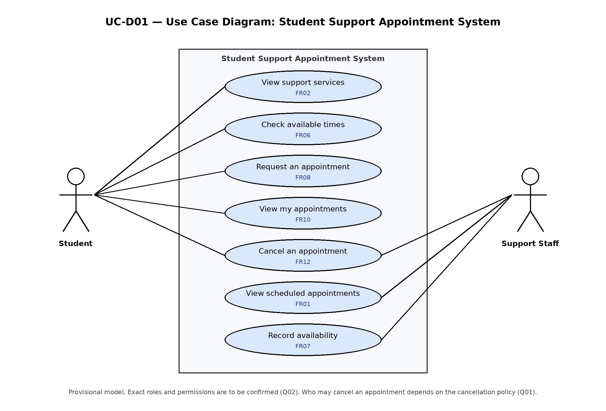
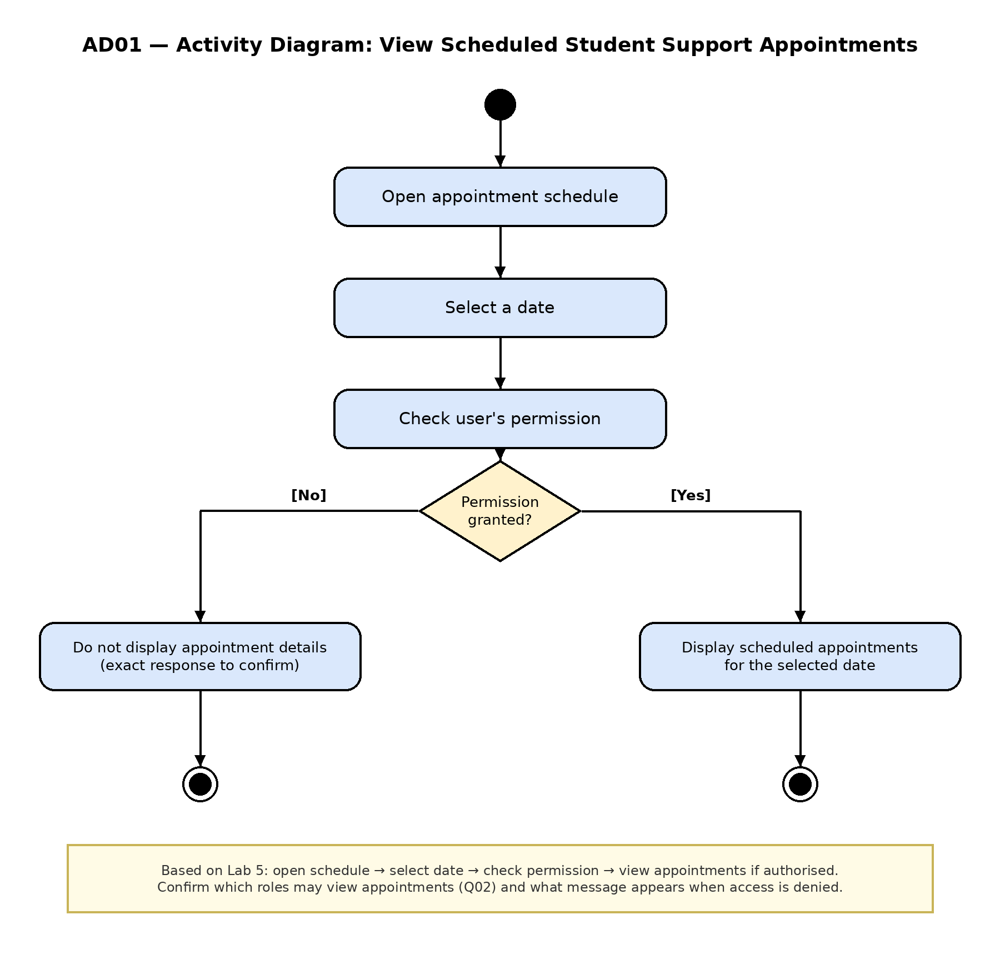
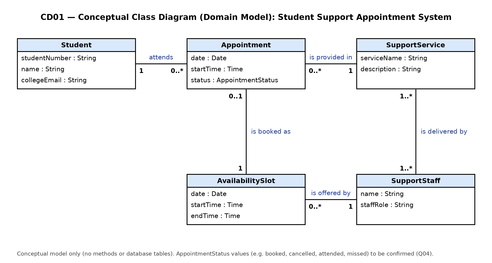
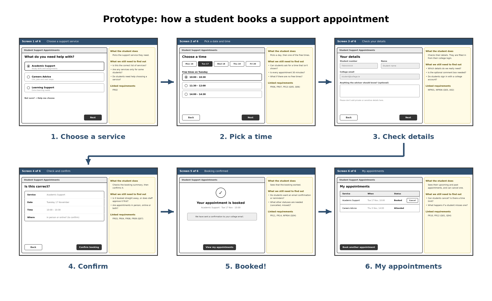
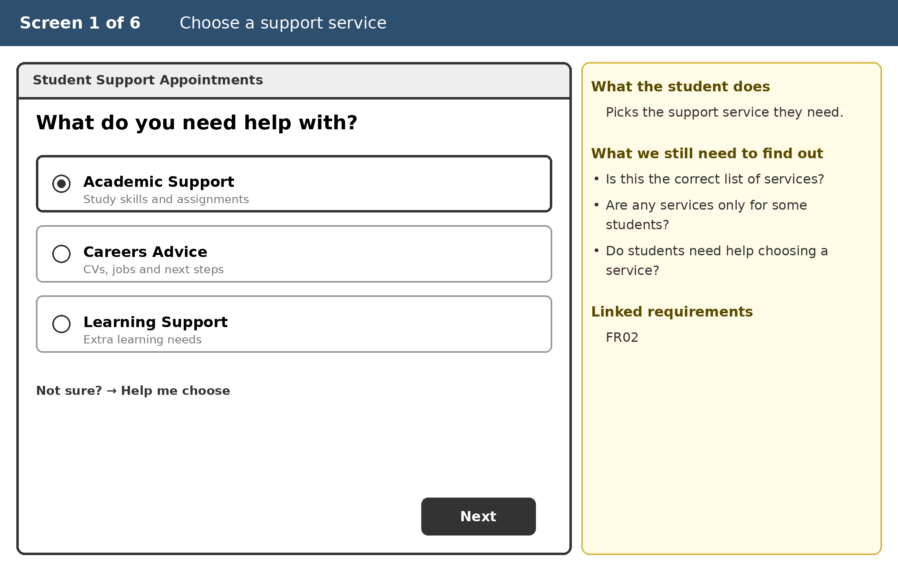
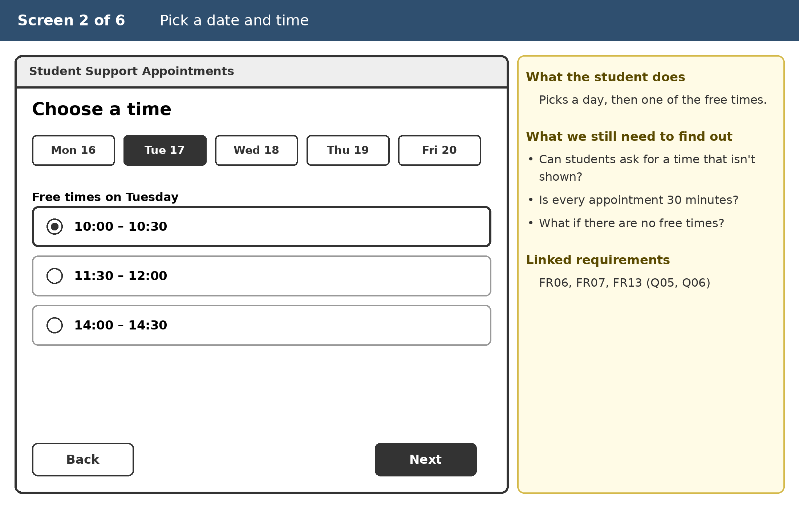
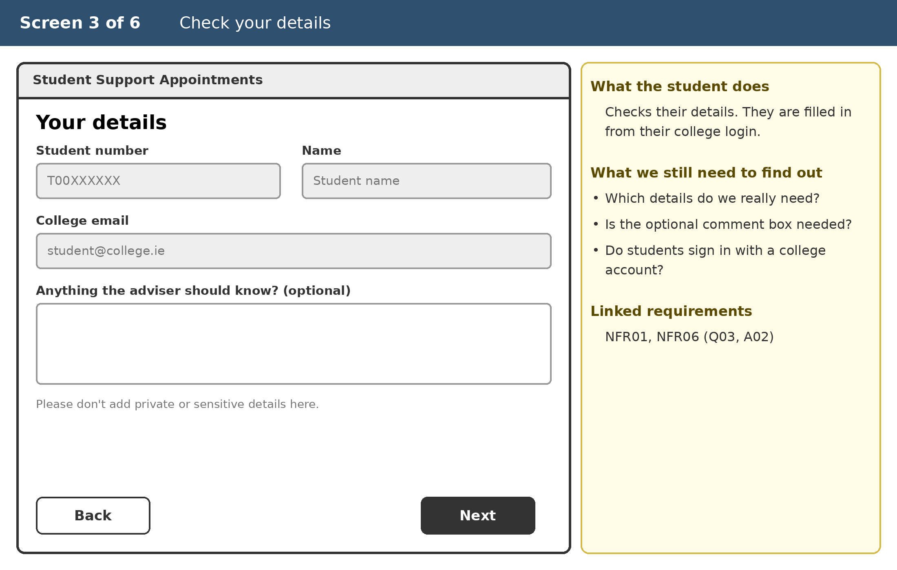
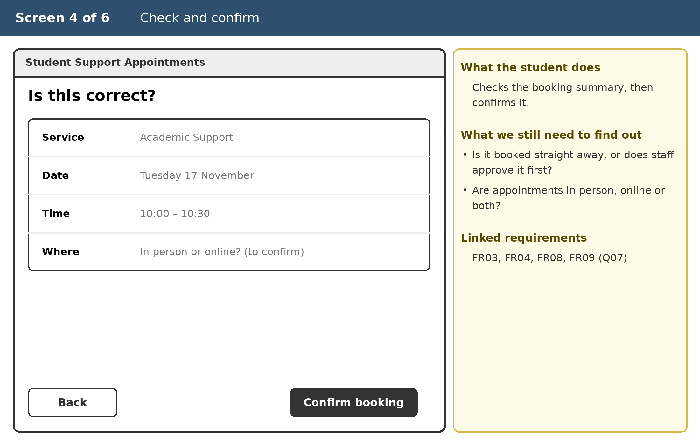
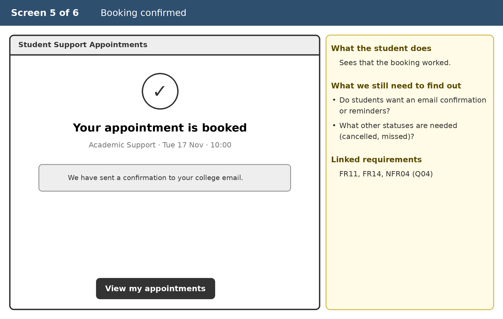
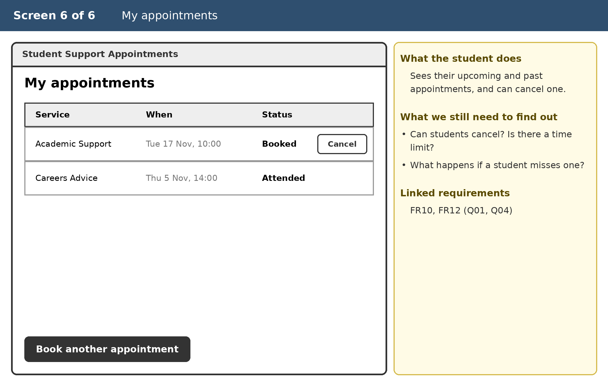

# Requirements Engineering Project — Draft Sections 1–4.2

**Scenario B: College Student Support Appointment System**

## 1. Problem, Stakeholders and Goals

### 1.1 Background and current situation

The college has student support services like academic support, careers advice, learning support.

Currently students are contacting the services by email or phone calls. For staff, they are scheduling appointments with calendars, spreadsheets or other informal ways.

This means it can be challenging for students to locate the service they require or check for the appointment availability. Also, staff may spend time manually managing the appointments. It can be challenging to make changes or cancellations. It's important to ensure the student's information is secure and that the system is accessible and user friendly.

All these issues are directly derived from the scenario B. We need to do more research to figure out the exact procedures for the college.

### 1.2 Problem statement and goals

**Problem:** Right now we have a mix of different informal processes for making appointments. That makes it difficult for students to find the right help, and difficult for us to track appointments.

**Goals:**
- Assist students in finding appropriate support services
- Ease the process of determining availability of appointments
- Minimize manual processing of appointments
- Ease the process of making adjustments to appointments
- Protect student's data
- Ensure accessibility and usability

### 1.3 Stakeholders, needs and proposed elicitation

**What are the proposed elicitation techniques:**
I would perform interviews to assess needs for students and staff. I would also look at existing forms and calendars for appointments (if available) to understand how the process works.

**What will you be asking:**
1. Students: what's the challenge to get a proper service or appointment.
2. Staff: who can make/alter/cancel appointments, what information is required.

| Stakeholder / role | Need or concern | Evidence / source |
|---|---|---|
| Student | Find the right service, check availability and arrange appointments. They also need privacy. | Scenario B & Week 2 Lab |
| Student support staff | View appointments, manage availability and handle changes. | Scenario B & Week 2 Lab |
| IT support staff | Maintaining the system and preventing technical issues or unauthorized access. | Week 1 & 2 Labs |
| College management | Reduce manual appointment handling, oversee support services and make sure student data is handled in line with data protection rules. | Assumed stakeholder based on Scenario B; to be confirmed |

### 1.4 Scope and system boundary

**In:** Show support services. Can check availability of appointments. Log appointments. View schedules. Maybe make changes or cancellations. Students request appointments online and view their own appointments. Support staff record the times they are available.

**Out:** Actually provide support services. Build separate mobile app. Integration with other systems at the college.

**Constraints:** Need to make sure student info is secure. Need to take accessibility and differing availabilities of staff into account.

### 1.5 Assumptions, candidate requirements and open questions

| ID | Type | Description | Evidence / status | Action needed |
|---|---|---|---|---|
| A01 | Assumption | Each appointment involves one student. | Not confirmed | Clarify with support staff |
| CR01 | Candidate requirement | Students should receive appointment reminders. | Proposed feature; recorded as FR14 (Could) | Ask whether reminders are needed |
| Q01 | Open question | Can students cancel appointments? | No rule supplied | Confirm cancellation policy |
| CR02 | Candidate requirement | Students should be able to request appointments online. | No rule supplied; recorded as FR08 (Must) | Ask students and support staff |
| Q02 | Open question | Who can create, change or cancel appointments? | Not specified | Confirm roles and permissions |
| Q03 | Open question | What information must be recorded for an appointment? | No rule supplied | Ask support staff and consider privacy needs |
| Q04 | Open question | What should happen when a student cancels or misses an appointment? | Not specified | Ask students and support staff |
| CR03 | Candidate requirement | Support staff should be able to record the times they are available for appointments. | Raised during domain modelling (CD01); recorded as FR07 | Confirm with support staff who manages availability |
| A02 | Assumption | Students and support staff sign in with an existing college account. | Not confirmed; basis of NFR06 | Confirm with IT support staff |
| Q05 | Open question | Can appointments be booked outside published availability slots? | Raised during domain modelling (CD01) | Confirm with support staff |
| Q06 | Open question | Are appointments a fixed length, or does the length vary by service? | Raised during prototyping (Screen 2) | Confirm with support staff |
| Q07 | Open question | Are appointments in person, online, or either? | Raised during prototyping (Screen 4) | Confirm with support staff |

## 2. Requirements Catalogue

See [`../requirements/requirements-catalogue.md`](../requirements/requirements-catalogue.md) (20 requirements: FR01–FR14 and NFR01–NFR06).

### 2.1 Requirements notes

The questions below were used to analyse FR01 (Who, What, When, Why and How will we know).

- Who? An authorised user; the exact role is unknown.
- What? View scheduled student support appointments.
- When? When the user opens the appointment schedule.
- Why? To let the relevant user see scheduled appointments.
- How will we know? Test that an authorised account can view appointments and that access follows the agreed permissions.
- Ambiguity: 'authorised user' in FR01, FR05 and NFR02 does not say which roles are meant. UC-D01 now separates Student and Support Staff, but the exact permissions are still open (Q02).
- Overlap: FR05 and NFR02 both cover access control. FR05 states the function (restricting who can view appointments) and NFR02 the security quality for all appointment information. They could be merged once the access rules are confirmed.
- NFR03 is about reviewing the prototype, which is a process requirement rather than a property of the system. NFR04 was added as a verifiable accessibility requirement for the system itself.
- Missing requirements: the first catalogue only covered staff viewing appointments. Domain modelling (CD01) and prototyping identified FR06–FR14 for availability, booking, appointment status, cancellation and confirmations. CR01, CR02 and CR03 are now recorded as FR14, FR08 and FR07.
- Unconfirmed rules: FR08 (instant booking or staff approval), FR11 (status values, Q04) and FR12 (cancellation policy, Q01) depend on rules that have not been supplied. They are written so they can be verified once the rule is agreed, and remain candidate requirements.
- Verifiability: words such as 'agreed' in FR02, NFR01 and NFR02 mean verification depends on information that is not yet confirmed. The 3-minute target in NFR05 is a proposed value that needs to be agreed with stakeholders.
- Possible conflict: FR14 (email confirmation) must not send more personal information than necessary, so it has to be checked against NFR01.

## 3. Requirements Modelling

### 3.1 Use Case Diagram (UC-D01)

Source file: [`UC-D01-use-case-diagram.drawio`](../diagrams/UC-D01-use-case-diagram.drawio)

UC-D01 shows the two main actors, Student and Support Staff, and the main use cases inside the system boundary. Each use case is labelled with the requirement it relates to. Students view services, check available times, request appointments, view their own appointments and cancel appointments (FR02, FR06, FR08, FR10, FR12). Support staff view the schedule, record their availability and may cancel appointments (FR01, FR07, FR12). The model is provisional because the exact roles and permissions (Q02) and who may cancel (Q01) are not confirmed.

### 3.2 One Use Case Narrative

| Field | Your content |
|---|---|
| Use case / ID | UC01 — View Scheduled Student Support Appointments |
| Primary actor / goal | Support staff (authorised user; exact role to be confirmed, Q02). Goal: View scheduled student support appointments. |
| Preconditions / trigger | The user opens the appointment schedule. The user's access permissions must be checked. |
| Main successful flow | 1. The user opens the appointment schedule. 2. The user selects a date. 3. The system checks the user's permission. 4. The system displays the scheduled appointments if permission is granted. |
| Alternative / exception flows | If the user is not permitted to view appointments, the appropriate response needs confirmation from the relevant stakeholder. |
| Outcome / postconditions | The authorized user can view the scheduled appointments they have permission to access. |
| Related requirements | FR01, FR05, NFR02, NFR06 |

### 3.3 Activity Diagram (AD01)

Source file: [`AD01-activity-diagram.drawio`](../diagrams/AD01-activity-diagram.drawio)

AD01 shows the workflow for viewing scheduled appointments, matching UC01. The user opens the schedule, selects a date and the system checks their permission. The guards [Yes] and [No] show the two outcomes. The response when access is denied is not specified in the scenario, so it is marked as needing confirmation. AD01 relates to FR01, FR05 and NFR02.

### 3.4 Conceptual UML Class Diagram (CD01)

Source file: [`CD01-class-diagram.drawio`](../diagrams/CD01-class-diagram.drawio)

Figure CD01 illustrates the key concepts of the domain as found in the Student Support Appointment system, and their inter-relationships. This is not a software design (there are no methods nor database tables). This is a conceptual view of the problem domain. Only those attributes that are necessary to support appointment making are identified (per NFR01). If a multiplicity is dependent upon an unproven rule, that is noted as an assumption or question (table below).

| Association / feature | Requirement evidence | Open question / assumption |
|---|---|---|
| Student 1 — 0..* Appointment (attends) | FR01, FR04; Scenario B | No appointment has more than one student assigned (A01). The number of appointments may range from zero (no appointments) to many. Appointments in a group are not modeled. |
| SupportService 1 — 0..* Appointment (is provided in) | FR02, FR03 | Each appointment is for exactly one service. A service may have no appointments yet. |
| AvailabilitySlot 1 — 0..1 Appointment (is booked as) | FR06, FR13; goal: ease checking availability | One slot holds at most one appointment, and slots may remain unbooked. Whether appointments can be made outside published slots is unconfirmed (Q05). |
| AvailabilitySlot 0..* — 1 SupportStaff (is offered by) | FR07; Section 1.3: staff manage availability | Each slot belongs to one staff member. Who creates slots, staff or an administrator, is unconfirmed (Q02). |
| SupportService 1..* — 1..* SupportStaff (is delivered by) | Scenario B; FR02 | Assumes each service has at least one staff member and staff may work across more than one service. To be confirmed with support staff. |
| Appointment.status | FR11; Q01, Q04 | Status values (e.g. booked, cancelled, attended, missed) depend on the cancellation and no-show policy, which is unconfirmed. |
| Student attributes (studentNumber, name, collegeEmail) | NFR01, FR05, NFR02 | Assumed minimum identifying information. The required data is to be confirmed (Q03). |

### 3.5 Model consistency check

The models were checked against each other and against the requirements catalogue to find mismatches, gaps and new questions. The use case narrative (UC01) and activity diagram (AD01) agree. Both follow the same flow: open the schedule, select a date, check permission, then display appointments if permission is granted. Both trace to FR01, FR05 and NFR02. The class diagram (CD01) supports FR02, FR03 and FR04 through the Support Service and Appointment classes and the date and time attributes. However, modelling revealed several inconsistencies and gaps, summarized below.

| Finding | Models affected | Action / status |
|---|---|---|
| UC-D01 originally used one generic 'Authorised user' actor, while CD01 separates Student and SupportStaff. | UC-D01, UC01, CD01 | UC-D01 updated with Student and Support Staff actors. Exact roles and permissions still to be confirmed (Q02). Partly resolved. |
| UC-D01 and AD01 originally only modelled viewing appointments. The goals and scope in Section 1 also include finding services, checking availability, requesting and cancelling appointments. | UC-D01, AD01, Section 1 | Use cases added to UC-D01 and FR06–FR12 added to the catalogue. AD01 still models the staff viewing flow; the student booking flow is explored in the prototype (Section 4). Resolved. |
| UC01 listed FR09, which did not exist in the catalogue at the time. | UC01 | Corrected to FR05. Resolved. |
| CD01 includes AvailabilitySlot, but no requirement covered staff recording their availability. | CD01, catalogue | Recorded as CR03 and added as FR07. Who manages availability is still open (Q02). Resolved. |
| The 0..1 multiplicity between AvailabilitySlot and Appointment implies a slot cannot be booked twice, but no requirement stated this. | CD01, catalogue | FR13 added. Resolved. |
| Appointment.status in CD01 implies a lifecycle (booked, cancelled, attended, missed) that no requirement or activity diagram covered. | CD01, AD01 | FR11 added. The status values depend on the cancellation and no-show policy (Q01, Q04). Open. |
| The denied-access outcome is unspecified in both UC01 and AD01. | UC01, AD01 | The models agree, but the response is unknown. Confirm the message or next action with stakeholders. Open. |
| CD01 links staff to appointments only through AvailabilitySlot. If appointments can be booked outside published slots, Appointment would need a direct link to SupportStaff. | CD01 | Depends on Q05. Open. |
| Student attributes in CD01 are assumed. NFR01 requires collecting only necessary data. | CD01, NFR01 | Confirm required student information (Q03). Open. |

Overall, the models are consistent for the 'view appointments' flow, but modelling showed that the first version of the requirements focused too narrowly on staff viewing schedules. FR06–FR14 were added to cover availability, booking, appointment status, cancellation and confirmations, and the use case diagram was updated to match. The remaining open items depend on stakeholders confirming user roles, the cancellation and no-show policy, and the information to be recorded.

## 4. Low-fidelity Prototype

### 4.1 Journey and purpose

The prototype explores the journey of a student booking an appointment with a student support service. It covers choosing a service, choosing an available time, confirming their details, reviewing and confirming the booking, and then viewing their appointments. This journey was chosen because the model consistency check (Section 3.5) showed that the original models and requirements focused mainly on staff viewing scheduled appointments. The student side of the process, which is central to the problem described in Section 1, had not yet been explored.

The prototype was used to investigate:
- whether the booking steps are clear and in a sensible order
- what information the student needs at each step to make a decision
- how staff availability could be shown to students (FR06, FR07)
- what personal information is genuinely needed (NFR01, Q03)
- where cancellation and appointment status fit into the journey (FR11, FR12, Q01, Q04)
- whether the screens raise accessibility concerns (NFR04)

Requirements explored: FR02, FR03, FR04, FR06–FR14, NFR01, NFR04 and NFR06. The screens are low-fidelity greyscale wireframes, not a finished interface design. The service names, dates and times shown are example data only. Each screen includes a notes panel linking it to requirement IDs and open questions.

### 4.2 Prototype screens

The six connected screens are shown below in the order a student would use them. The full prototype is also in [`Prototype-Student-Booking-Journey.pdf`](../prototype/Prototype-Student-Booking-Journey.pdf).

**Screen 1 – Choose a service:** The student selects the support service they need. Linked to FR02. A 'help choosing' option was added because a student may not know which service fits their problem.

**Screen 2 – Choose a time:** The student picks a date and one of the free times shown. Linked to FR06, FR07 and FR13, and the AvailabilitySlot concept in CD01. Raises Q05 and Q06.

**Screen 3 – Your details:** The student's details are pre-filled from their college account, with an optional comment field. Linked to NFR01 and NFR06. Raises Q03 and relies on assumption A02.

**Screen 4 – Check and confirm:** The student reviews the service, date, time and location before confirming. Linked to FR03, FR04, FR08 and FR09. Raises Q07.

**Screen 5 – Booking confirmed:** Confirms the appointment with the status 'booked' and mentions an email confirmation. Linked to FR11, FR14 and NFR04.

**Screen 6 – My appointments:** The student views their upcoming and past appointments, with a Cancel option shown to explore the cancellation policy. Linked to FR10, FR12, Q01 and Q04.

## Next sections to complete

- 4.3 Walkthrough, findings and improvements: record a review that was actually carried out (self-review or peer walkthrough).
- Section 5: explain selected NFRs already in the catalogue (NFR01–NFR06).
- Section 6: priorities and the lecturer's actual change request; do not invent the request.
- Section 7: 3–5 user stories with testable acceptance criteria.
- Section 8: traceability, review and validation evidence.
- Section 9: actual GitHub repository link and genuine commit examples.
- Section 10: accurate AI Use Record.
